# diffusion-pick

Imitation learning from pixels for **"put the red cube in the bowl"** with a MuJoCo Franka Panda
(MuJoCo Menagerie). A scripted IK expert produces 200 demonstrations; a **CNN Diffusion Policy**
(ResNet18 encoders, action chunking, DDIM sampling) and an **ACT** baseline are trained from
**RGB (wrist + front) + proprioception only** and evaluated on 100 randomized rollouts plus
robustness tests (distractors, lighting, camera shift). The policies are exported to ONNX.

Everything here — data, training, evaluation, GIFs, ONNX — was produced on a **4-core CPU-only VM**
(software OpenGL via EGL/llvmpipe) with the reduced 64x64 configs. A full-resolution config for a
single A10 GPU is included.

The project has had two iterations. **v1** is the baseline: Diffusion Policy vs ACT. **v2** addresses
the two failure modes found in v1, using Diffusion Policy only (ACT keeps its v1 numbers as the baseline):
1. **No recovery after a missed grasp.** v2 adds 100 demos from a perturbation expert that deliberately
   misses, knocks, closes too high or drops the cube, and then re-grasps.
2. **Distractor and lighting sensitivity.** v2 adds train-time robustness: strong photometric
   augmentation and random distractor objects in the demos. Nothing changes at test time.

## v2 results: recovery demos + train-time robustness

Same architecture (`dp_reduced`), optimizer, schedule (12k steps), checkpoint-selection protocol, and
the **same 4 test conditions on the same 100 test seeds** as v1. The test environment code paths are
unchanged: the training-only distractor pool is only built when `train_distractors > 0`, and the test
distractors, lighting and camera perturbations are the v1 ones.

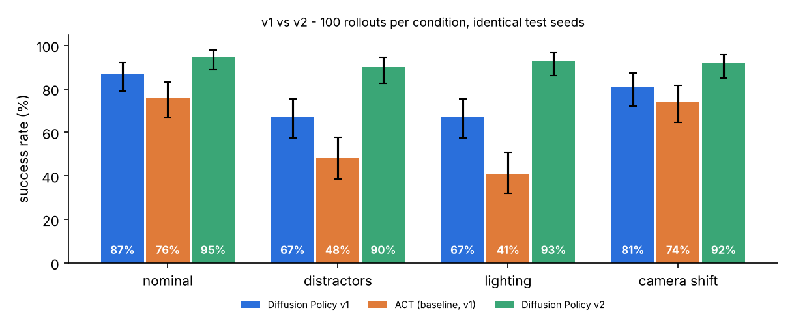

| Policy | nominal | distractors | lighting | camera shift |
|---|---|---|---|---|
| ACT (baseline, v1) | 76% | 48% | 41% | 74% |
| Diffusion Policy v1 | 87% | 67% | 67% | 81% |
| **Diffusion Policy v2** | **95%** (CI 89-98) | **90%** (CI 83-94) | **93%** (CI 86-97) | **92%** (CI 85-96) |

Paired comparison on identical seeds (`scripts/compare_paired.py`, exact McNemar test):

| condition | v1 | v2 | Δ | v1 fail → v2 success | v1 success → v2 fail | McNemar p |
|---|---|---|---|---|---|---|
| nominal | 87% | **95%** | +8 | 13 | 5 | 0.096 |
| distractors | 67% | **90%** | +23 | 29 | 6 | 1.2e-4 |
| lighting | 67% | **93%** | +26 | 28 | 2 | 8.7e-7 |
| camera shift | 81% | **92%** | +11 | 18 | 7 | 0.043 |

<!-- ABLATION -->

### What changed in v2

**1. Recovery demos (`ScriptedExpert(recovery=True)`, `scripts/generate_demos.py --recovery`).** Each
recovery episode injects exactly one deliberate mistake on the first grasp attempt:

| perturbation | what the expert does | share of the 100 demos |
|---|---|---|
| miss | grasp target offset 3–4.5 cm perpendicular to the finger closing direction, so the fingers close beside the cube (often clipping it) | 48 |
| knock | offset along the closing direction, so a finger lands on the cube and pushes or tilts it | 16 |
| high | gripper closes 3.5–5 cm above the cube | 16 |
| drop | gripper opens for 2–3 steps early in the transfer, so the cube falls | 20 |

After every close and during lift/transfer, the expert checks the grasp from the gripper state (finger
width > 2.5 cm and cube within 4 cm of the TCP). On failure it re-opens, rises above the cube's *current*
pose, re-aligns to its (possibly changed) yaw, and re-grasps, up to 3 times. An episode is kept only if
it succeeds **and** contains a failed grasp followed by a second grasp. That gave 100 demos from 145
attempts, 76 steps each on average.
The **deliberate-mistake actions are masked out of training** (`expert_mask = 0`, 897 steps): every
sample whose action chunk overlaps a mistake is dropped (2,013 of 17,669 samples). The policy
therefore sees the bad states, such as a cube knocked aside or a gripper closed on nothing, but only
learns the corrective actions. I chose perturbation demos over DAgger because the state-machine
expert can label "what to do now" from any state only once it has an explicit grasp check, and
perturbations give targeted coverage of exactly the v1 failure (missed or knocked grasps).

**2. Train-time robustness.**
* **Random distractors in the demos.** The 200 base demos were re-rendered from the same seeds (same
  cube/bowl layouts and expert trajectories) with 0–3 objects per episode from a *training-only* pool of
  8 shapes (`TRAIN_POOL_SPECS`: bars, cylinders, a sphere, a capsule, an ellipsoid, a flat box). Their
  colors are re-sampled each episode from the whole HSV space except near-red (hue within ±25° of red
  with saturation > 0.35). The recovery demos also have distractors. The fixed test distractors (yellow
  cube, purple cylinder, orange bar) are never used in training, but random colors do cover their
  hues, so the distractor test now measures generalization to *unseen objects* rather than to unseen
  colors.
* **Strong photometric augmentation** (`augment_strong`), applied per sample and per camera, consistent
  across the 2-frame observation window: brightness x[0.55, 1.45], contrast x[0.65, 1.35], saturation
  x[0.7, 1.4], per-channel gain x[0.8, 1.2] (tint), a random linear illumination gradient (±35%, random
  direction), and pixel noise, on top of the v1 random shift. There is no hue rotation, so red stays
  red. Lighting in the simulator is never randomized for training.

| v2 dataset | episodes | steps |
|---|---|---|
| `data/demos_64_distract.zarr` (v1 seeds + train distractors) | 200 | 10,040 |
| `data/recovery_64_distract.zarr` (recovery + train distractors) | 100 | 7,629 |
| total used by `configs/dp_v2.yaml` | 300 | 17,669 (15,656 training samples after masking) |

### v2 details

| | Diffusion Policy v2 |
|---|---|
| training | 12k steps, batch 64, 116 min on 4 CPU cores (same per-step cost as v1) |
| checkpoint selection (24 selection-seed rollouts) | 8k 96%, 10k 92%, 12k 96%; tie, so the later one (12k), as in v1 |
| mean episode length of successes (nominal) | 57.8 steps (v1: 52.6; longer partly because of re-grasps) |
| successes with more than one gripper-close command (nominal / distractors / lighting / camera) | 22 / 15 / 16 / 17. This is an *upper bound* on re-grasps: brief gripper-command flicker also counts. |
| ONNX | `exports/dp_v2.onnx`, 27 MB, max abs error vs PyTorch 1.8e-7, 32 ms per chunk on an idle CPU |
| closed loop with ONNX only (first 20 test seeds) | 18/20 (90%) |

**Remaining failures (30 of 400 episodes).** 14 never close the gripper: the policy hesitates and
hovers, for example between the red cube and a distractor, or near the bowl in dim light. The other
16 keep re-trying the grasp (4–8 close commands) until the 150-step limit. Re-grasping is now a
learned behavior, but it does not always converge.

| | v2 |
|---|---|
| recovery (v1 **failed** this seed: grasp knocks the cube, the policy re-approaches and re-grasps) | 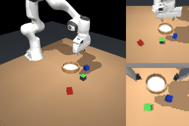 |
| v1 on the same seed (reaches the cube, fails to grasp, then hovers without retrying) |  |
| distractors | 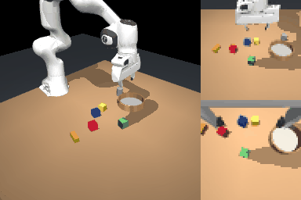 |
| lighting | 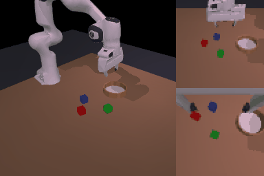 |
| camera shift | 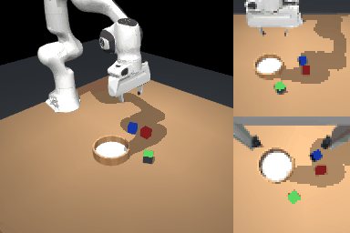 |
| failure: hesitation with distractors | 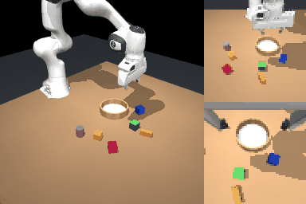 |

## v1 results (baseline iteration)

100 randomized rollouts per condition on held-out test seeds (`1000000-1000099`, disjoint from the
demo seeds; identical cube/bowl layouts across conditions and policies), max 150 steps (15 s) per
episode, success = red cube resting inside the bowl and released.

| Policy | train steps | nominal | distractors | lighting | camera_shift |
|---|---|---|---|---|---|
| Diffusion Policy (CNN, DDIM-10) [`dp_reduced`] | 12000 | **87%** (87/100, 95% CI 79-92) | **67%** (67/100, 95% CI 57-75) | **67%** (67/100, 95% CI 57-75) | **81%** (81/100, 95% CI 72-87) |
| ACT [`act_reduced`] | 5000 | **76%** (76/100, 95% CI 67-83) | **48%** (48/100, 95% CI 38-58) | **41%** (41/100, 95% CI 32-51) | **74%** (74/100, 95% CI 65-82) |

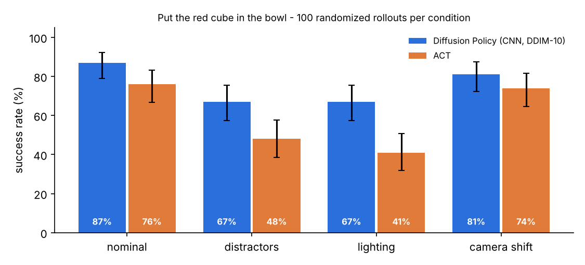

| | Diffusion Policy | ACT |
|---|---|---|
| training | 12k steps, batch 64 (~77 epochs), ~110 min (0.55 s/step)* | 10k steps, batch 64, 70 min (0.42 s/step; selected ckpt: 5k) |
| mean episode length of successes (nominal) | 52.6 steps | 47.6 steps (expert demos: 50.2) |
| ONNX file | `exports/dp_reduced.onnx`, 27 MB, DDIM-10 unrolled | `exports/act_reduced.onnx`, 9.6 MB |
| ONNX vs PyTorch max abs error | 5e-7 | 3e-6 |
| onnxruntime CPU latency per chunk (batch 1, 2 threads) | 60 ms | 4 ms |
| closed-loop with ONNX only (`scripts/eval_onnx.py`, first 20 test seeds) | 18/20 (90%) | 16/20 (80%, chunk execution, no temporal ensembling) |

\* The DP run was planned for 24k steps. A quick check at step 4k already gave 7/12 successes, so it
was resumed from that checkpoint with the cosine schedule shortened to 12k steps to save CPU time.

**Checkpoint selection.** Checkpoints were compared on 24 rollouts on separate *selection* seeds
(`500000+`, never used for the test numbers above). DP: 8k 75%, 10k 96%, 12k 96%, so the final 12k
checkpoint was used. ACT: 5k 83%, 7.5k 79%, 10k 79%, so 5k was used.

**Takeaways**
* With the same encoder budget and data, Diffusion Policy beats ACT on nominal (87% vs 76%). The gap is
  largest under the visual shifts: distractors 67% vs 48%, lighting 67% vs 41%.
* Camera shift (±3 cm / ±3° on the front camera) costs little for either policy (-6 / -2 points). The
  wrist camera, which does not move, plus random-shift augmentation seem to cover this.
* Distractors and lighting changes hurt most. Neither appears in training (the color jitter is
  milder than the lighting test). In the failure GIFs the policy goes for the wrong object (the
  orange bar next to the red cube; the green cube under dim light). The other common failure, also on
  nominal, is a grasp that slightly misses and knocks the cube. The policy then hovers, because the
  expert data never shows a re-grasp.
* These are small, quickly trained CPU models (64x64 images, ResNet18 at 1/4 width). Expect higher
  numbers from the full config.

Rollout GIFs (left: high-res third-person view for visualization only; right: the policy's actual
64x64 front and wrist inputs, upscaled; green border = success):

| | Diffusion Policy | ACT |
|---|---|---|
| nominal | 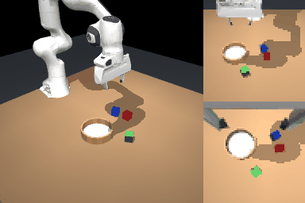 |  |
| distractors |  |  |
| lighting | 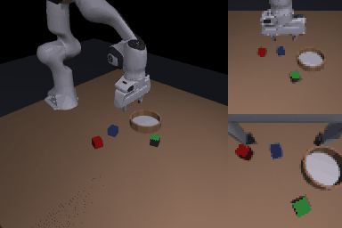 |  |
| camera shift |  |  |
| DP failures | 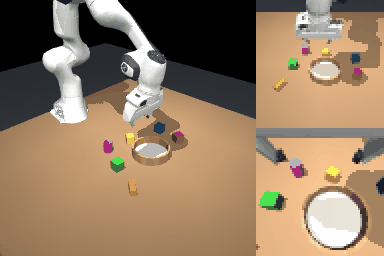 | 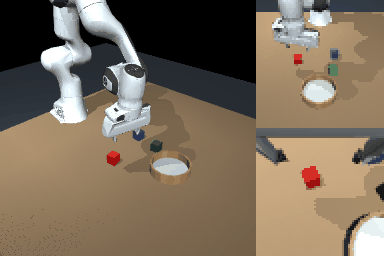 |

All GIFs: `results/*/gifs/`. Per-episode outcomes: `results/*/results.json`.
Rollouts are stochastic (DDIM noise and unseeded torch RNG), so a re-run gives statistically
equivalent, not bit-identical, numbers.


## Task & environment (`dpick/env.py`)

| | |
|---|---|
| Robot | Franka Emika Panda from MuJoCo Menagerie (`assets/franka_emika_panda`, Apache-2.0), gravity-compensated position servos |
| Scene | Table, 3 cubes (red / green / blue, 4 cm) with random position + yaw, a bowl (static, random position) |
| Randomization | cube & bowl positions over a 26 x 44 cm workspace (min. separations enforced), cube yaw in [-45°, 45°] (= all orientations, cube is 90°-symmetric), initial arm joints ~ home + N(0, 0.06 rad) |
| Observations | `front_rgb` (fixed third-person cam), `wrist_rgb` (hand-mounted cam), `proprio` (12-D: TCP xyz, sin/cos yaw, finger width, joints 1-6) |
| Action (10 Hz) | absolute TCP target `[x, y, z, yaw, grip]`; a 250 Hz damped-least-squares IK loop (with null-space posture regulation) converts it to joint targets |
| Success | red cube center inside the bowl (radius 6.5 cm from center), resting on the bowl floor, and released by the gripper |
| Rendering | `MUJOCO_GL=egl` (default, set by the package) or `osmesa`. Panda visual meshes are decimated 134k -> 17k triangles (`scripts/make_lite_meshes.py`, `PANDA_VISUAL=lite`, default) which makes llvmpipe rendering ~4.5x faster; collision geometry is untouched. `PANDA_VISUAL=full` uses the original meshes (re-generate data if you switch). |

Robustness conditions (same seeds -> identical cube/bowl layouts across conditions; perturbations use a separate RNG):

* **distractors** – 3 extra objects (yellow cube, purple cylinder, orange bar) placed among the cubes
* **lighting** – key-light intensity x[0.35, 1.7], color tint ±25%, random light direction/position, headlight/ambient x[0.3, 1.5]
* **camera_shift** – front camera translated by up to ±3 cm per axis and rotated by up to ±3° (wrist camera unchanged)

None of these perturbations appear in the training data (training uses random-shift + color-jitter augmentation only).

## Expert & data (`dpick/expert.py`, `scripts/generate_demos.py`)

A waypoint state machine on absolute TCP targets: approach above the red cube (yaw-aligned to the
cube) → descend → close → lift → transfer (with a random lateral detour) → lower → release → retreat.
Per-episode randomization: speed 0.18–0.32 m/s, approach / lift / release heights, grasp height and
xy offsets, placement offset inside the bowl, gripper close / open dwell times. DART-style noise
(σ = 4 mm) is added to the *executed* action during approach and transfer while the clean action is
recorded, so the data contains small recoveries. Only successful episodes are kept.

`data/demos_64.zarr`: **200 demos, 10,035 steps** (38–68 steps per episode, mean 50), 64x64 images,
expert success rate under DART noise 200/233 (86%).

```
data/front_rgb (N,64,64,3) uint8   data/wrist_rgb (N,64,64,3) uint8
data/proprio   (N,12) float32      data/action    (N,5) float32
meta/episode_ends (200,) int64     attrs: seeds, img_size, noise, ...
```

## Policies

### Diffusion Policy (`dpick/models/diffusion.py`)

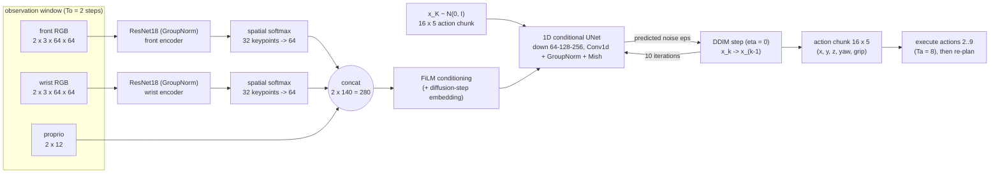

* **Encoders**: one ResNet18 per camera (BasicBlock [2,2,2,2]); BatchNorm replaced by GroupNorm as in
  Diffusion Policy. Reduced config: channel width 16 (1/4 of standard) and a 3x3/stride-2 stem without
  max-pool so 64x64 images give a 4x4 layer-4 feature map. Full config: standard width 64, standard
  7x7 stem, 128x128 inputs. Spatial-softmax keypoints -> linear -> ReLU features.
* **Noise model**: DP's `ConditionalUnet1D` over the action sequence, with FiLM conditioning on
  [step embedding, flattened obs features of both timesteps].
* **Diffusion**: 100 training steps with the squared-cosine schedule and epsilon prediction (MSE).
  Inference uses deterministic **DDIM with 10 steps** and x0 clipping to [-1, 1].
* **Action chunking**: predict Tp = 16 steps starting at t - 1 (To = 2), execute Ta = 8 steps
  open-loop, then re-plan (receding horizon).
* **Training**: AdamW (lr 3e-4, cosine, 500 warm-up steps), batch 64, EMA of weights (DP power-0.75 warm-up)
  used for evaluation, random-shift (±4 px) + brightness/contrast/saturation (±20%) augmentation,
  actions and proprio min-max normalized to [-1, 1].

### ACT baseline (`dpick/models/act.py`)

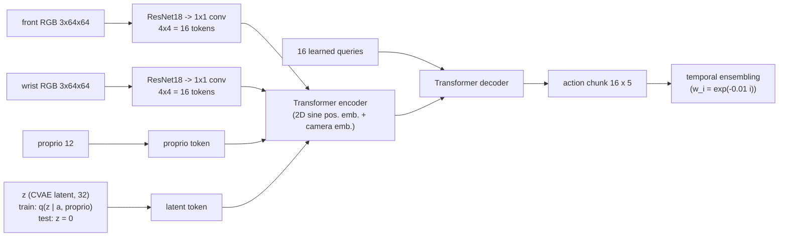

* Same ResNet18 encoders as DP (feature-map tokens instead of spatial softmax), current frame only.
* CVAE posterior encoder (transformer over [CLS, proprio, action chunk]) used during training only;
  loss = L1(action chunk) + 10 * KL.
* Reduced config: d_model 128, 4 heads, 2 encoder / 2 decoder / 2 CVAE layers. Full config: d_model 256,
  8 heads, 4/4/4 layers, backbone lr 1e-5.
* At test time the policy is queried every step and overlapping chunk predictions are averaged
  (ACT's temporal ensembling).
* Attention is written with plain matmuls so both models export to ONNX unchanged.

### Model sizes / configs

| config | image | encoder | head | params | where |
|---|---|---|---|---|---|
| `dp_reduced` | 64x64 | 2x ResNet18 width 16 | UNet 64-128-256 | 6.5 M | CPU (this repo's numbers) |
| `act_reduced` | 64x64 | 2x ResNet18 width 16 | d=128, 2+2 layers | 2.8 M | CPU (this repo's numbers) |
| `dp_full` | 128x128 | 2x ResNet18 width 64 | UNet 256-512-1024 | 93 M | A10 |
| `act_full` | 128x128 | 2x ResNet18 width 64 | d=256, 4+4 layers | 39 M | A10 |


## Reproduce

```bash
pip install -r requirements.txt
# Ubuntu: apt-get install -y libegl1 libgl1-mesa-dri libosmesa6   (headless rendering)
```

```bash
python scripts/generate_demos.py --n 200 --img-size 64 --out data/demos_64.zarr
```

```bash
python scripts/train.py --config configs/dp_reduced.yaml
```

```bash
python scripts/train.py --config configs/act_reduced.yaml
```

```bash
python scripts/evaluate.py --ckpt runs/dp_reduced/best.pt --n 100 --out results/dp_reduced
```

```bash
python scripts/export_onnx.py --ckpt runs/dp_reduced/best.pt --out exports/dp_reduced.onnx
```

```bash
python scripts/make_report.py results/dp_reduced results/act_reduced
```

### v2 (recovery + robustness)

```bash
python scripts/generate_demos.py --n 200 --train-distractors 3 --out data/demos_64_distract.zarr
```

```bash
python scripts/generate_demos.py --n 100 --recovery --train-distractors 3 --seed-offset 200000 --out data/recovery_64_distract.zarr
```

```bash
python scripts/train.py --config configs/dp_v2.yaml
```

```bash
python scripts/evaluate.py --ckpt runs/dp_v2/best.pt --n 100 --out results/dp_v2
```

```bash
python scripts/compare_paired.py results/dp_reduced results/dp_v2
```

Ablation data: `data/recovery_64.zarr` (the same recovery seeds without distractors:
`--recovery --seed-offset 200000`). Ablation configs: `configs/dp_v2_recovery_only.yaml`, `configs/dp_v2_aug_only.yaml`.
For the full-res version of v2, generate the same files with `--img-size 128` and set `aug_strong: true`
plus the two-file `data:` list in `configs/dp_full.yaml`.

### Full-resolution run (A10)

```bash
python scripts/generate_demos.py --n 200 --img-size 128 --out data/demos_128.zarr
```

```bash
python scripts/train.py --config configs/dp_full.yaml
```

```bash
python scripts/train.py --config configs/act_full.yaml
```

`get_device()` picks `cuda` > `mps` > `cpu` automatically (override with `--device`). On CUDA,
training uses bf16 autocast. Rendering on the GPU box also works with `MUJOCO_GL=egl` (NVIDIA EGL).
Evaluation runs policy inference on CPU workers (one per core), so it is the same command.

## Repository layout

```
assets/franka_emika_panda/   Menagerie Panda (+ assets_lite/ decimated visual meshes)
dpick/env.py                 MuJoCo env, IK controller, randomization, robustness perturbations
dpick/expert.py              scripted expert (+ v2 recovery mode: deliberate mistakes, grasp check, re-grasp)
dpick/dataset.py             zarr I/O, normalizers, sequence dataset
dpick/models/common.py       device selection, GroupNorm ResNet18, spatial softmax, augmentation, EMA
dpick/models/diffusion.py    1D conditional UNet, cosine DDPM schedule, DDIM sampler, DiffusionPolicy
dpick/models/act.py          ACT (CVAE + transformer encoder/decoder)
dpick/rollout.py             closed-loop execution (receding horizon / temporal ensembling), GIF frames
configs/                     dp_reduced / act_reduced (CPU), dp_full / act_full (A10),
                             dp_v2 + ablations dp_v2_recovery_only / dp_v2_aug_only (CPU)
scripts/                     generate_demos, train, evaluate, export_onnx, eval_onnx, make_report,
                             compare_paired, render_failures, render_seeds, make_lite_meshes
data/demos_64.zarr           the 200 v1 demonstrations
data/*_distract.zarr, data/recovery_64*.zarr   v2 data (train distractors / recovery demos)
runs/*/best.pt               selected checkpoints (+ train_log.jsonl)
results/                     results.json per policy, results.md, success_rates.png, GIFs
exports/                     ONNX models + metadata json
```
